<h1 align="center">SkillMatch</h1>

<p align="center">
  <b>Moving From Static, Unverified Skill Matching Toward a Dynamic and Explainable Framework for Part-Time Workforce Platforms</b>
</p>

<p align="center">
  
  
  
  
</p>

---

## Table of Contents

1. [Overview](#1-overview)
2. [Key Features](#2-key-features)
3. [Repository Structure](#3-repository-structure)
4. [Environment and Installation](#4-environment-and-installation)
5. [Usage](#5-usage)
6. [Experimental Setup](#6-experimental-setup)
7. [Results](#7-results)
8. [Limitations](#8-limitations)
9. [Research Paper](#9-research-paper)
10. [Authors](#10-authors)

---

## 1. Overview

Existing worker–task matching systems typically depend on self-reported resumes and static profiles. They rarely verify whether a claimed skill is genuine, and they do not learn from how workers actually perform.

**SkillMatch** is a working prototype of a *dynamic, verified, and explainable* matching framework for part-time workforce platforms. It:

- separates **claimed**, **verified**, and **demonstrated** skills;
- scores every worker–task pair with a weighted compatibility function, preceded by a feasibility gate;
- updates worker proficiency from completed-task outcomes;
- produces a factor-level explanation for every recommendation;
- performs stable two-sided assignment; and
- exposes the results through a Flask web dashboard.

Because real data containing verified proficiency and task outcomes are not publicly available, the framework is evaluated in a **controlled, time-aware simulation** with known ground truth (600 workers, 600 evaluation tasks per run, six epochs, 20 random seeds).

### Compatibility Score

```
M(w, t) = α·S_skill + β·S_ver + γ·S_exp + δ·S_pref + ε·S_avail + ζ·S_perf
```

| Term | Meaning |
|---|---|
| `S_skill` | Semantic skill similarity |
| `S_ver` | Verified capability |
| `S_exp` | Experience relevance |
| `S_pref` | Bilateral preference alignment |
| `S_avail` | Temporal and location availability |
| `S_perf` | Demonstrated performance from completed tasks |

The coefficients are non-negative, sum to one, and are tuned by random search on separate development seeds.

### Profile Update Rule

```
p_new(s) = (1 − λ_eff) · p_old(s) + λ_eff · E(s)        λ = 0.3, feedback reliability = 0.8  →  λ_eff = 0.24
```

---

## 2. Key Features

| Feature | Description |
|---|---|
| Skill taxonomy | 48 skills in 8 clusters with a skill-similarity graph |
| Evidence status | Each worker–skill pair is `none`, `claimed`, `verified`, `demonstrated`, or `rejected` |
| Feasibility gate | Hard constraints on availability, location, and mandatory verified evidence are applied before ranking |
| Dynamic profiles | Proficiency is updated from noisy task outcomes, applied only when evidence meets the verification policy |
| Explainability | Each factor contribution `wᵢ·Sᵢ` is listed, blocking factors are flagged, and verified skills are distinguished from merely claimed ones |
| Stable assignment | Task-proposing deferred acceptance over task-side scores and worker-side preferences |
| Dashboard | Flask interface showing the top-5 workers per task with explanations, and a feedback form that updates profiles immediately |

---

## 3. Repository Structure

```
skillmatch/
├── app.py                    # Flask dashboard (presentation layer)
├── run_experiments.py        # Weight tuning, main test run, ablations, sweeps, fairness, latency
├── make_figures.py           # Generates results/fig_*.png
├── make_report.py            # Generates results/PAPER_RESULTS.md (all tables)
├── requirements.txt
├── PAPER_TEXT.md
├── skillmatch/
│   ├── taxonomy.py           # Skills, clusters, similarity graph
│   ├── simulate.py           # Synthetic workers/tasks, claim inflation, hidden ground truth
│   ├── model.py              # M(w,t), feasibility gate, profile update, explanations, matching
│   ├── pipeline.py           # Time-aware epochs, baselines, ranking metrics
│   └── embed.py              # Optional SBERT hook (replaces the skill-graph similarity)
├── results/                  # CSVs, JSON, figures, PAPER_RESULTS.md
└── docs/
    ├── paper/                # Research paper (PDF)
    └── screenshots/          # Output screenshots used in this README
```

---

## 4. Environment and Installation

### Tested Environment

| Component | Version |
|---|---|
| Operating system | Microsoft Windows |
| Python | 3.10.11 (virtual environment) |
| NumPy | 2.2.6 |
| pandas | 2.3.3 |
| SciPy | 1.15.3 |
| scikit-learn | 1.7.2 |
| Matplotlib | 3.10.9 |
| Flask | 3.1.3 |
| Execution | Single-process CPU |
| IDE | Visual Studio Code |

<p align="center">
  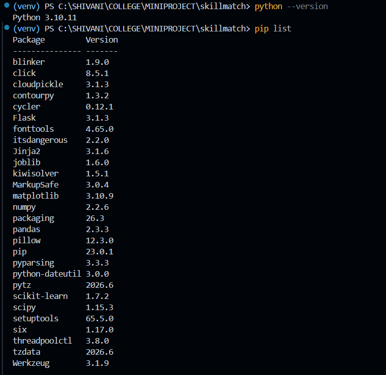
</p>
<p align="center"><i>Figure 1. Python runtime and installed package versions.</i></p>

### Installation

```bash
# 1. Clone the repository
git clone <https://github.com/Shivani5106/Dynamic-and-Explainable-Skill-Matching-for-Part-Time-Workforce-Platforms.git>
cd skillmatch

# 2. Create and activate a virtual environment
python -m venv venv

# Windows (PowerShell)
venv\Scripts\Activate.ps1
# macOS / Linux
source venv/bin/activate

# 3. Install dependencies
pip install -r requirements.txt
```

> **Optional:** install `sentence-transformers` to replace the skill-graph similarity with SBERT embeddings (see `skillmatch/embed.py`).

---

## 5. Usage

Run the following from the repository root.

| Step | Command | Output |
|---|---|---|
| 1. Run all experiments | `python run_experiments.py` | CSV and JSON files in `results/` |
| 1a. Quick smoke test | `python run_experiments.py --quick` | Reduced run (about 1 minute) |
| 2. Generate figures | `python make_figures.py` | `results/fig_*.png` |
| 3. Generate report tables | `python make_report.py` | `results/PAPER_RESULTS.md` |
| 4. Launch the dashboard | `python app.py` | <http://127.0.0.1:5000> |

On macOS/Linux, if the `skillmatch` package is not found, prefix commands with `PYTHONPATH=.`.

### Experiment Run

The complete suite finishes in **442 seconds** on a single CPU process. The console output below shows weight tuning on development seeds, the main test run, and the sensitivity sweeps.

<p align="center">
  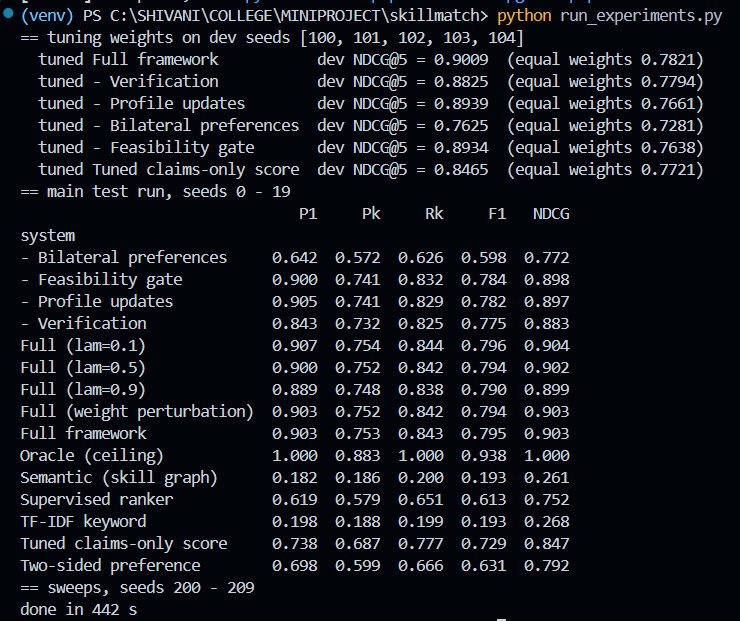
</p>
<p align="center"><i>Figure 2. Console output of <code>run_experiments.py</code>.</i></p>

---

## 6. Experimental Setup

| Parameter | Value |
|---|---|
| Workers | 600 |
| New tasks ranked per epoch | 100 (600 evaluation tasks per run) |
| Epochs | 6 (epoch 0 is the cold start) |
| Historical hires fed back per epoch | 300 (claim-based matching, i.e. a static platform) |
| Workers who inflate claims | 35% (2–4 skills they do not hold) |
| Verification access | Group A: 0.80, Group B: 0.50 |
| Verifier accuracy | Accepts a true skill with probability 0.92 and a false claim with probability 0.08 |
| Outcome noise (SD) | 0.12 |
| Weight tuning | Random search, 600 candidate vectors per variant |
| Development seeds | 100–104 |
| Test seeds | 0–19 |
| Sweep seeds | 200–209 |

**Baselines**

1. TF-IDF keyword matching
2. Semantic matching (skill graph, standing in for embedding-based matching)
3. Gradient-boosted supervised ranker, trained on earlier epochs only
4. Two-sided preference matching
5. Weight-tuned claims-only control (same tuning budget, no verification or performance terms)

**Metrics:** P@1, P@5, R@5, F1@5, and NDCG@5 with 95% confidence intervals over seeds, plus paired t-tests for the ablations.

---

## 7. Results

All values are mean ± 95% CI over simulation seeds. The oracle uses ground truth and is a ceiling, not a real system.

### 7.1 Headline Findings

| Finding | Result |
|---|---|
| Full framework NDCG@5 | **0.903** (baselines: 0.261–0.792) |
| Tuned claims-only control | 0.847, so the full framework improves on it by +0.056 |
| Contribution of verification | +0.020 NDCG@5 (20/20 seeds, p < 0.001) |
| Contribution of profile updates | +0.006 average, about +0.013 by epoch 5 |
| Assignment success (deferred acceptance) | 85.4% for the full framework, against 67.0% (two-sided preference) and 60.0% (supervised ranker) |
| Fairness cost | Group B is under-represented in the top-5 by 3.9 percentage points |
| Inference latency | About 11 ms per task with factor-level explanations (600 workers) |

### 7.2 Main Comparison (Table A)

<p align="center">
  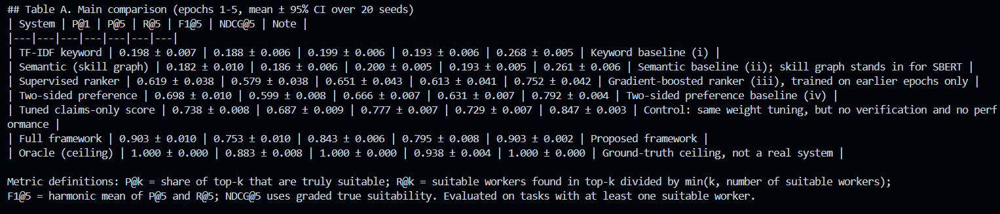
</p>
<p align="center"><i>Table A. Main comparison on epochs 1–5 (mean ± 95% CI over 20 seeds).</i></p>

<p align="center">
  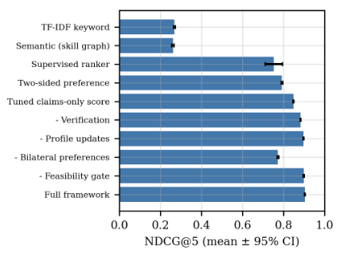
</p>
<p align="center"><i>Figure 3. NDCG@5 for baselines, the claims-only control, the full framework, and its ablations.</i></p>

### 7.3 Ablation Study (Table B)

<p align="center">
  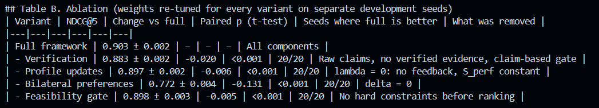
</p>
<p align="center"><i>Table B. Ablation with weights re-tuned for every variant on separate development seeds.</i></p>

> **Note:** The large drop from removing bilateral preferences (−0.131) largely reflects the simulator defining suitability to require preference compatibility. It should not be read as independent evidence for that component.

### 7.4 Learning Curve and Profile Adaptation (Table C)

<p align="center">
  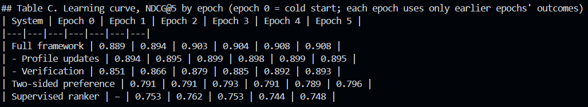
</p>
<p align="center"><i>Table C. NDCG@5 by epoch (epoch 0 is the cold start; each epoch uses only earlier epochs' outcomes).</i></p>

<p align="center">
  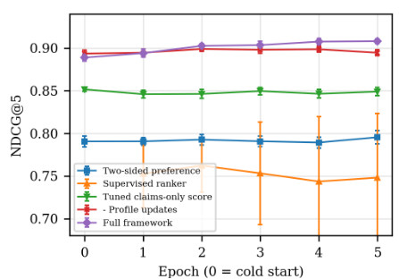
</p>
<p align="center"><i>Figure 4. NDCG@5 by epoch.</i></p>

With profile updates, NDCG@5 rises from 0.889 at cold start to 0.908 at epoch 5. Verification helps most at cold start (0.889 against 0.851 without it).

### 7.5 Robustness to Claim Inflation (Table D)

<p align="center">
  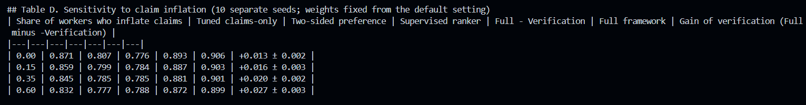
</p>
<p align="center"><i>Table D. Sensitivity to claim inflation (10 separate seeds; weights fixed from the default setting).</i></p>

<p align="center">
  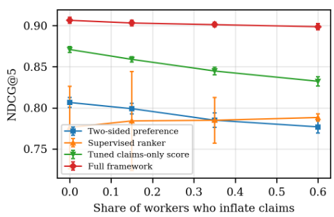
</p>
<p align="center"><i>Figure 5. NDCG@5 against the share of workers who inflate their claims.</i></p>

The gain from verification grows from +0.013 (no inflation) to +0.027 (60% inflation). The claims-only control falls from 0.871 to 0.832, while the full framework moves only from 0.906 to 0.899.

### 7.6 Fairness Analysis (Tables E and F)

Group B is given lower verification access by assumption. Group membership is **never** used as a model feature.

<p align="center">
  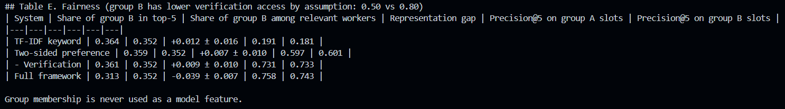
</p>
<p align="center"><i>Table E. Representation of group B in the top-5 and precision by group.</i></p>

<p align="center">
  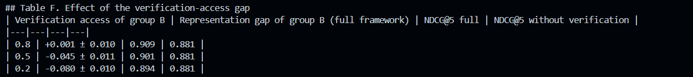
</p>
<p align="center"><i>Table F. Effect of the verification-access gap on representation.</i></p>

Verification improves accuracy but can disadvantage workers who cannot readily obtain evidence. The representation gap grows to 8.0 percentage points when group B's verification access falls to 0.20, and vanishes at equal access. Alternative evidence routes (for example, short skill assessments) and routine fairness audits are needed.

### 7.7 Stable Two-Sided Assignment (Table G)

<p align="center">
  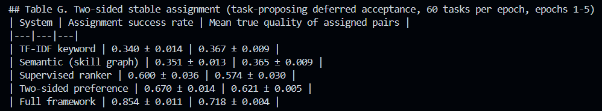
</p>
<p align="center"><i>Table G. Task-proposing deferred acceptance (60 tasks per epoch, epochs 1–5).</i></p>

### 7.8 Efficiency

| Measure | Value |
|---|---|
| Ranked recommendation with factor-level explanation | 11.3 ms per task (600 workers) |
| Profile update | 0.0035 ms |
| Complete experiment suite | 442 s |

Timings depend on hardware and are reported for the single-process Windows host described in [Section 4](#4-environment-and-installation).

---

## 8. Limitations

1. All results come from a simulator whose assumptions were chosen by the authors (inflation rate, verifier accuracy, definition of suitability). Different assumptions would change the numbers.
2. Verification-quality statistics reflect the assumed verifier accuracy and are consistency checks, not findings.
3. Feedback is attributed equally to every required skill of a task, which is a simplification.
4. The supervised baseline learns from logs of claim-based hires, which are a selected sample.
5. The embedding baseline uses a skill graph rather than a pretrained sentence encoder.
6. Confidence intervals and p-values describe variation across simulation seeds, not real-world uncertainty.
7. Group B's lower verification access is an assumption used to probe fairness, not a measured fact.
8. User trust and explanation faithfulness were not evaluated empirically. Trust requires a user study, and faithfulness is exact for an additive score.

**Future work:** validation on real worker–task data, pretrained sentence embeddings in place of the skill graph, a user trust study, and fairness mitigations such as alternative evidence routes.

> **Results are simulation-based and require validation on real platform data.**

---

## 9. Research Paper

The full paper is included in this repository: [`docs/paper/Skill_Matching_Paper.pdf`](docs/paper/Skill_Matching_Paper.pdf)

Every table and figure above can be regenerated from the code. `results/PAPER_RESULTS.md` is produced by `make_report.py` directly from the result CSVs.

**Suggested citation**

```
D. J., S. M., and M. Y. Y., "Moving From Static, Unverified Skill Matching Toward a
Dynamic and Explainable Framework for Part-Time Workforce Platforms,"
Saveetha Engineering College, Chennai, India.
```

---

## 10. Authors

| Name | Affiliation |
|---|---|
| Dhanalakshmi J, Assistant Professor | Department of Information Technology, Saveetha Engineering College, Chennai, India |
| Shivani M | Department of Computer Science and Engineering, Saveetha Engineering College, Chennai, India |
| Mohammed Yaasir Y | Department of Computer Science and Engineering, Saveetha Engineering College, Chennai, India |
